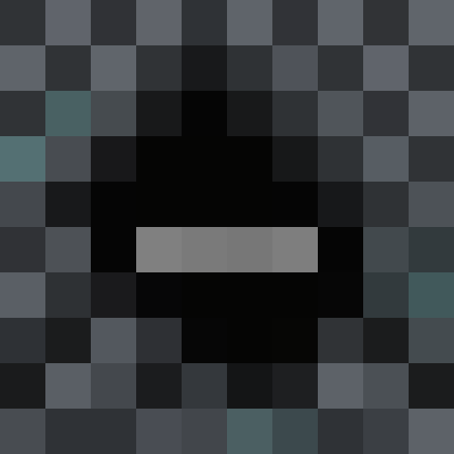

# CavesLite

Rare creatures, eerie cave ambience and Herobrine encounters for **Minecraft Java 26.3 · Paper/Purpur · Java 25**. No client mod or resource pack required.

**2.0.0-preview.1 — testing preview, not the final 2.0 release.**

[Guía en español](docs/CONFIGURATION.es.md) · [English guide](docs/CONFIGURATION.en.md) · [Giant mechanics](docs/GIANT.en.md) · [Pruebas / testing](docs/TESTING.md) · [Changelog](CHANGELOG.md)

## What's in this preview

- 18 configurable creatures, plus independently timed Herobrine encounters.
- A sparse starter preset: 12 creatures enabled, six disabled; 10% replacement attempt chance, cooldowns and active caps.
- An opt-in performance preset with fewer custom encounters. Nether spawning is OFF per creature by default; natural encounters exclude the End.
- Native administration dialogs in white and grays. Enabled encounters have white names; disabled encounters have gray struck-through names.
- A giant with plugin-owned ground navigation, basic attacks, warned stomps, earthquake waves, bounded zombie reinforcements and customizable loot. No terrain destruction by giant abilities.
- Herobrine pursuit between accessible elevations, repeated melee attacks and expiration driven by a monotonic encounter clock, independent of world time.
- Optional Vault rewards and PlaceholderAPI statistics. Neither dependency is required.

## Install

1. Use Paper/Purpur 26.3 and Java 25. Folia is not supported.
2. Stop the server, place **CavesLite-2.0.0-preview.1.jar** in `plugins/`, remove the previous CavesLite JAR, then start the server.
3. Check your real world names in `plugins/CavesLite/config.yml`; the starter preset allows `world`.
4. Open `/clite` as OP or with `caveslite.command`.

Existing config and language files are preserved. **Updating the JAR does not apply the new starter preset to an old config.** To use the approved starter settings, back up your config and copy `plugins/CavesLite/presets/basic.yml` to `plugins/CavesLite/config.yml`, then use `/clite reload`. For a fresh installation, these are already the defaults.

## Quick commands

| Command | Purpose |
|---|---|
| `/clite` | Main dialog; select a creature or Herobrine |
| `/clite options` | Global feature toggles |
| `/clite list` | Creature IDs |
| `/clite summon <mob> [x y z [world]]` | Manual test spawn |
| `/clite summon herobrine [player] [type]` | Manual Herobrine encounter |
| `/clite debug mobs [mob]` | Loaded creatures and locations |
| `/clite debug herobrine [player]` | Encounter, timing and attack diagnosis |
| `/clite kill [mob]` | Remove CavesLite encounters/artifacts; includes Herobrine |
| `/clite kills [player]` | Custom-mob kill count |
| `/clite reload` | Reload settings, languages and dialogs |

Alias: `/caveslite`. Manual summons are not natural-spawn tests. Giant summons require enough physical room; Herobrine summons respect the per-player encounter cap.

## Build and verify

```sh
gradle build --no-daemon
```

JDK 25 and Gradle are required. The build compiles the plugin, runs the verification harnesses and creates the JAR in `build/libs/`. GitHub Actions uses Ubuntu 24.04 and v5 actions; its downloadable artifact is named `CavesLite`.

Source lives in `src/main/`, verification tools in `tools/verification/`, current documentation in `docs/`, historical material in `docs/history/`. Compiled JARs are distributed as release artifacts, not tracked source files.

## Español

CavesLite añade criaturas y encuentros poco comunes, Herobrine y ambientación subterránea. La preview 2.0 incluye la configuración básica acordada: **12 mobs activos, seis desactivados, Herobrine activo y Nether desactivado**. Puedes ajustar cada encuentro desde los Dialogs y todos los parámetros avanzados en YAML.

La probabilidad general y los pesos son ajustes diferentes: 10% no significa que el 10% de todos los mobs del servidor serán especiales. Consulta la [guía completa](docs/CONFIGURATION.es.md), las [mecánicas del gigante](docs/GIANT.es.md) y la [pauta de pruebas](docs/TESTING.md) antes de dar por aprobada la preview.

## Credits and license

Inspired by Dangerous Caves 2. Historical attribution and MIT terms are preserved in [LICENSE](LICENSE). CavesLite is independently maintained by Italo. The giant implementation is original and uses the Paper API; no external mod/plugin code or client assets are bundled.
